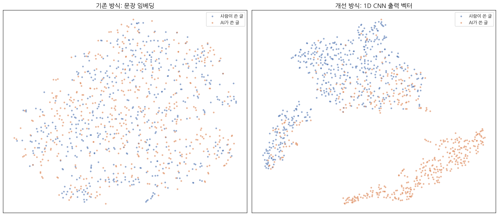
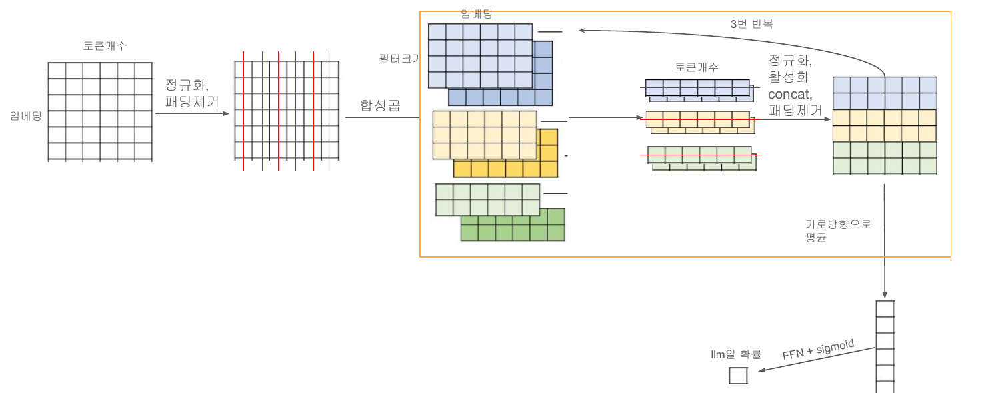
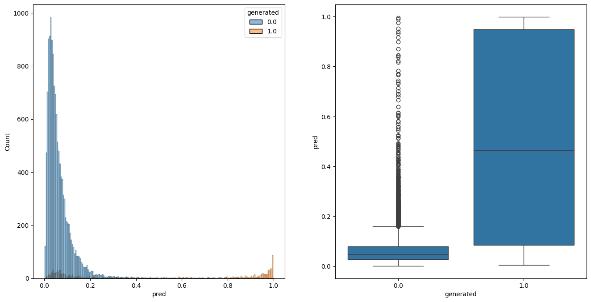
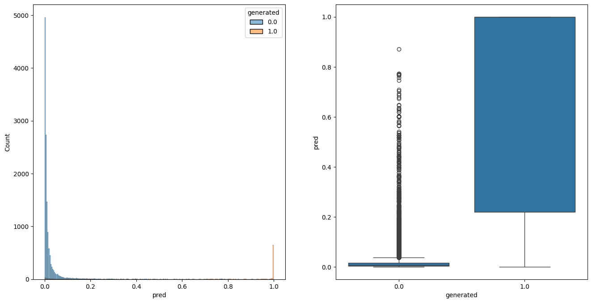
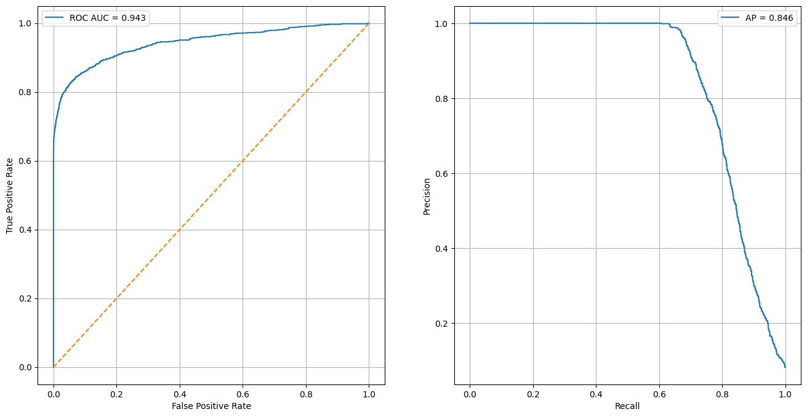

# AI 생성 텍스트 판별 모델

> 문장의 **의미**가 아닌 **문체**에 주목해, AI가 쓴 글과 사람이 쓴 글을 구분하는 한국어 분류 모델

[LLM 과목] 팀 프로젝트 | [2025.09 ~ 2025.12] | 2인 팀

**담당 역할**: 팀장. 모델 설계·구현 총괄, 문체 기반 분류 방식(BERT + 1D CNN) 제안 및 구현

<br>

## 결과

| 모델 | 학습 에폭 | Accuracy | **F1 Score** |
|---|:---:|:---:|:---:|
| 기존 방식 (문장 의미 기반) | 1 | 0.949 | 0.557 |
| 기존 방식 (문장 의미 기반) | 5 | 0.953 | 0.616 |
| **개선 방식 (문체 기반, BERT + 1D CNN)** | 1 | 0.966 | **0.751** |
| **개선 방식 (문체 기반, BERT + 1D CNN)** | 5 | 0.971 | **0.794** |

- 같은 학습 조건(5 에폭)에서 F1 점수 **0.616 → 0.794** (약 18%p 향상)
- 개선 모델 ROC AUC **0.943**, PR AUC(AP) **0.846**

> 데이터에서 AI가 쓴 글의 비중이 매우 적어, 정확도(Accuracy)는 모든 글을 "사람"으로만 예측해도 높게 나옵니다.
> 그래서 소수 클래스(AI 글)를 얼마나 잘 찾아내는지를 반영하는 **F1 Score**를 주요 지표로 사용했습니다.

<br>

## 문제 해결 과정

### 1. 문장 의미 기반 분류의 한계

처음에는 AI가 쓴 글과 사람이 쓴 글이 내용에서 차이가 날 것으로 보고, BERT(`klue/bert-base`)의 문장 임베딩으로 의미 기반 분류를 시도했습니다.
하지만 F1 점수가 0.6 안팎에 머물렀고, 특히 AI 글을 놓치는 경우(낮은 재현율)가 많았습니다.

분류 헤드에 문제가 있다고 보고 여러 구조를 시도했지만 성능은 크게 달라지지 않았습니다.

### 2. 원인 분석: 임베딩을 직접 확인

분류 헤드가 아닌 **입력 단계**에 원인이 있을 수 있다고 보고, 헤드로 들어가는 문장 임베딩을 직접 확인했습니다.
AI가 쓴 글과 사람이 쓴 글 일부를 임베딩한 뒤 산점도로 시각화하자, 두 클래스가 섞여 있어 구분되지 않았습니다.

두 글이 다루는 **내용 자체가 비슷해서**, 의미를 담은 임베딩만으로는 어떤 헤드를 써도 구분이 어렵다는 결론을 내렸습니다.



> 검증 데이터에서 사람 글과 AI 글을 500개씩 뽑아 t-SNE로 2차원에 나타낸 그림입니다. (프로젝트 이후 같은 데이터와 모델로 다시 그렸습니다)
> - **왼쪽(기존 방식)**: 문장 임베딩에서는 두 클래스가 전체적으로 고르게 섞여 있어, 분류 헤드를 바꿔도 경계를 긋기 어렵습니다.
> - **오른쪽(개선 방식)**: 1D CNN을 거친 벡터에서는 AI 글 상당수가 별도의 군집(오른쪽 아래)으로 모이고, 사람 글도 따로 모입니다. 다만 위쪽 군집에는 두 클래스가 섞인 영역이 남아 있으며, 이는 아직 구분하지 못하는 글이 있다는 뜻이기도 합니다.

### 3. 가설: 의미가 아닌 문체로 구분하기

LLM 서비스마다 답변 스타일이 다르다는 점에서 착안했습니다.
학습 데이터의 AI 글은 소수의 모델로 만들어졌을 가능성이 높고, 그렇다면 **그 모델들이 반복적으로 보이는 문체 패턴**을 학습해 판별할 수 있다고 보았습니다.

문체는 특정 어미, 표현, 문장 구성처럼 **짧은 구간에서 반복되는 국소적 특징**이라고 판단해, 국소 패턴 추출에 강한 **1D CNN**을 적용했습니다.

### 4. 마감 일정을 고려한 구현

마감이 얼마 남지 않아 전체 구조를 바꾸기는 어려운 상황이었습니다.
그래서 1D CNN의 출력 벡터를 기존 문장 임베딩과 **같은 형식(배치, 차원)**으로 맞춰, 분류 헤드와 학습·평가 코드는 그대로 두고 **임베딩 부분만 교체**했습니다.

<br>

## 모델 구조



<details>
<summary>흐름도로 보기</summary>


</details>

**베이스 모델 선정**: `klue/bert-base`(한국어 특화, 약 1억 1천만 파라미터)
BERT 가중치는 고정하고 상위 모듈만 학습하므로 모델 크기가 학습 부담으로 이어지지 않았고, 임베딩 결과를 그대로 분류에 쓰기 때문에 임베딩 품질이 좋은 모델을 선택했습니다.

| 구분 | 기존 방식 | 개선 방식 |
|---|---|---|
| BERT 출력 | 문장 전체를 대표하는 벡터 1개 | **토큰별 임베딩** 전체 |
| 특징 추출 | 문장의 의미 | 1D CNN으로 **국소적인 문체 패턴** 추출 |
| 학습 대상 | 분류 헤드 | 1D CNN + 분류 헤드 (BERT는 고정) |

**설계 의도**
1. **임베딩을 길이 1로 정규화**: 문체를 파악하는 데는 세부적인 의미가 필요 없다고 보고, 벡터의 방향만 남겨 대략적인 의미만 유지했습니다. 벡터 크기까지 남기면 값의 범위가 너무 다양해 학습이 어려울 것이라고 판단했습니다.
2. **패딩 제거**: 패딩 위치의 값을 0으로 만들어 연산에서 제외했습니다. 문장 길이에 따라 패딩이 달라지는 것이 결과에 영향을 주지 않도록 하기 위해서입니다.
3. **크기가 다른 3개의 필터(3, 5, 7)**: 필터마다 서로 다른 범위의 문체를 봅니다. 작은 필터는 세세한 표현을, 큰 필터는 넓은 범위의 문장 구성을 포착하며, 세 결과를 이어 붙여 함께 사용합니다.
4. **필터별 정규화(Instance Norm)**: 필터마다 합성곱 결과의 스케일을 맞춰 학습을 안정시키되, 따로 정규화해 각 필터가 잡아낸 특징이 섞이지 않도록 했습니다.
5. **마스크 가중 평균 풀링**: 3층의 합성곱을 거친 결과를 패딩을 제외하고 토큰 방향으로 평균 내어 하나의 벡터로 만든 뒤 분류합니다.

<br>

## 예측 분포 비교 (5 에폭)

| 기존 방식 | 개선 방식 |
|:---:|:---:|
|  |  |

개선 방식에서 사람 글(0)의 예측값은 0에, AI 글(1)의 예측값은 1에 더 뚜렷하게 모였습니다.



<br>

## 프로젝트 구조

```
├── default.ipynb       # 기존 방식: 문장 임베딩 기반 분류 (베이스라인)
├── best.ipynb          # 개선 방식: BERT + Multi-Kernel 1D CNN
├── utils/
│   ├── models.py       # 모델 구조, 학습·평가 함수
│   └── preprocess.py   # 데이터 로딩, 토크나이징, 클래스 비율 유지 분할
└── requirement.txt
```

## 실행 방법

```bash
pip install -r requirement.txt
```

1. 데이터셋(`full_text`, `generated` 컬럼)을 `Text Classification Dataset/train.csv` 경로에 둡니다. [데이터 출처]
2. `default.ipynb`(베이스라인) 또는 `best.ipynb`(개선 모델)을 순서대로 실행합니다.

- 데이터는 클래스 비율을 유지하며 학습 70% / 검증 15% / 테스트 15%로 분할합니다.
- CUDA GPU 환경을 기준으로 작성되었습니다.

## 기술 스택

Python, PyTorch, Hugging Face Transformers, scikit-learn, pandas, seaborn

<br>

## 회고

- **원인은 생각과 다른 곳에 있을 수 있다**: 분류 헤드만 바꾸며 시간을 썼지만, 실제 원인은 입력 데이터의 표현 방식에 있었습니다. 문제가 다른 고려하지 않은 곳에 있을 수 있다는 것을 느꼈습니다.
- **한계와 개선 방향**: 산점도에서 보이듯 일부 AI 글은 여전히 사람 글과 섞여 있습니다. 이런 글들의 공통점을 분석하면 다음 개선 방향을 찾을 수 있을 것입니다. 또한 학습 데이터에 없는 새로운 LLM의 문체에는 성능이 떨어질 수 있습니다.
